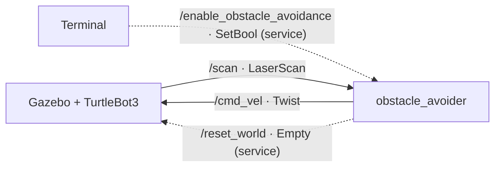
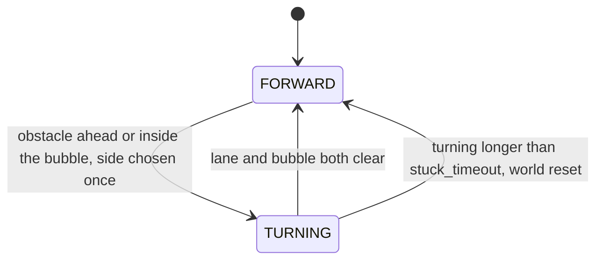

# Atlas — TurtleBot3 Obstacle Avoider

A ROS 2 node that drives a simulated TurtleBot3 on its own, detecting obstacles with the LiDAR and steering around them. Developed for Task 2 of the ATLAS recruitment (Control & Mission Planning, AeroTéc, Técnico Lisboa, 2026/27).

## Overview

The robot drives forward until its LiDAR detects an obstacle ahead, then turns in place towards the side with more free space and resumes driving once the path is clear. A short-range "safety bubble" stops it from scraping obstacles beside its body, and if it ever turns for too long it assumes it is stuck and asks Gazebo to reset the world. Navigation can be paused and resumed at any time through a ROS service, and the robot stops itself when the node is shut down.

The node exercises the three mechanisms the task asks for: **publishing** (`/cmd_vel`), **subscribing** (`/scan`) and **services** (one server, one client).

## Requirements

- Ubuntu 22.04 (tested on WSL 2)
- ROS 2 Humble
- Gazebo 11 (Classic)
- TurtleBot3 packages:

```bash
sudo apt install ros-humble-gazebo-ros-pkgs ros-humble-turtlebot3 \
  ros-humble-turtlebot3-msgs ros-humble-turtlebot3-simulations
```

- The TurtleBot3 model set to burger:

```bash
export TURTLEBOT3_MODEL=burger
```

On WSL, Gazebo may need software rendering to avoid a black or crashing window:

```bash
export LIBGL_ALWAYS_SOFTWARE=1
```

## Build

Place the package in the `src` folder of a ROS 2 workspace, then build and source it:

```bash
mkdir -p ~/atlas_ws/src
cd ~/atlas_ws/src
git clone git@github.com:luis-machado00/Atlas-turtlebot3_obstacle.git turtlebot3_obstacle
cd ~/atlas_ws
colcon build --symlink-install
source install/setup.bash
```

## Run

**Terminal 1 — the simulation:**

```bash
ros2 launch turtlebot3_gazebo turtlebot3_world.launch.py
```

Wait until the robot appears in Gazebo. On slow machines the first launch can time out before the robot spawns; if only the world appears, stop it with Ctrl+C, run `killall -9 gzserver gzclient` and launch again.

**Terminal 2 — the node:**

```bash
ros2 run turtlebot3_obstacle obstacle_avoider
```

Any parameter can be changed at start-up, for example:

```bash
ros2 run turtlebot3_obstacle obstacle_avoider --ros-args -p forward_speed:=0.2
```

Press **Ctrl+C** to stop the node; the robot stops with it.

Optionally, for shorter log lines without ROS's absolute timestamp (the node prints its own elapsed time):

```bash
export RCUTILS_CONSOLE_OUTPUT_FORMAT="[{severity}] [{name}]: {message}"
```

## ROS interfaces



| Name | Type | Role |
|---|---|---|
| `/scan` | `sensor_msgs/msg/LaserScan` | Subscribed. LiDAR readings, received with the sensor-data QoS profile (best effort). |
| `/cmd_vel` | `geometry_msgs/msg/Twist` | Published at 10 Hz. Forward and angular velocity commands. |
| `/enable_obstacle_avoidance` | `std_srvs/srv/SetBool` | Service server. `true` resumes navigation, `false` stops the robot. |
| `/reset_world` | `std_srvs/srv/Empty` | Service client. Called when the robot is stuck. Provided by Gazebo. |

Pause and resume the robot:

```bash
ros2 service call /enable_obstacle_avoidance std_srvs/srv/SetBool "{data: false}"
ros2 service call /enable_obstacle_avoidance std_srvs/srv/SetBool "{data: true}"
```

## Parameters

All parameters are read once, when the node starts. Change them with `--ros-args -p name:=value`.

| Name | Default | Description |
|---|---|---|
| `stop_distance` | 0.4 | Front distance (m) below which the robot starts turning |
| `clear_distance` | 0.6 | Front distance (m) above which it may drive again |
| `near_distance` | 0.25 | Safety-bubble distance (m) around the front half of the body |
| `forward_speed` | 0.1 | Forward speed (m/s) |
| `turn_speed` | 0.5 | Turning speed (rad/s) |
| `stuck_timeout` | 15.0 | Turning time (s) after which the world is reset |
| `start_front`, `end_front` | -15, 15 | Front sector (degrees) |
| `start_left`, `end_left` | 60, 120 | Left sector (degrees) |
| `start_right`, `end_right` | 240, 300 | Right sector (degrees) |
| `start_near`, `end_near` | -70, 70 | Safety-bubble sector (degrees) |

Angles follow the ROS convention (REP 103): 0° is straight ahead and angles grow counter-clockwise, so 90° is left and 270° is right. Distances and speeds must be written as decimals (`20.0`, not `20`); sector angles are integers.

## How it works

### Sensor sectors

The LiDAR returns 360 distances, one per degree, with index 0 pointing straight ahead. Instead of trusting a single ray, the node takes the **closest valid reading** inside four sectors:

- **Front** (±15°) — the lane the robot is about to drive into.
- **Left** (60° to 120°) and **right** (240° to 300°) — used to choose which way to turn.
- **Near** (±70°) — the safety bubble, described below.

The ±15° front width is not arbitrary: the burger is about 18 cm wide, and at the 0.4 m reaction distance its half-width covers tan⁻¹(0.09 / 0.40) ≈ 13°. A single ray straight ahead would miss obstacles slightly off-centre that would still hit the robot's side.

Readings outside the sensor's valid range `[range_min, range_max]` are discarded, as the `LaserScan` message definition prescribes. This removes `inf`, `0.0` and `NaN` values, which would otherwise make the robot see walls that are not there. A sector with no valid readings is treated as clear.

### State machine

The robot is always in one of two states:



- **FORWARD** — drives at `forward_speed`. If the front is closer than `stop_distance`, or anything is inside the bubble, it picks a turn direction and switches to TURNING.
- **TURNING** — rotates in place at `turn_speed` until the path is clear.

The turn direction (towards the side with more space) is chosen **once**, when the turn begins, and kept until it ends. An earlier version re-decided every cycle; with an obstacle on the edge of the left sector, the decision flipped back and forth and the robot wiggled in place forever.

### Hysteresis

The robot starts turning below **0.4 m** but only drives again above **0.6 m**. With a single threshold it would stop turning the moment the obstacle was barely out of range, drive a couple of centimetres, and start turning again — a stutter. The gap between the two thresholds makes it finish each turn properly.

### Safety bubble

Testing showed a failure the front sector alone cannot handle: placed very close to a cylinder, the robot turned until the cylinder left the ±15° lane, drove forward, and hit it again with its side. The lane was sized for obstacles 0.4 m away, but at 0.15 m an obstacle 40–60° to the side is still in the robot's path.

The bubble (±70°, 0.25 m) covers that case. Turning starts if the lane **or** the bubble is blocked, and only stops when the lane **and** the bubble are clear. It deliberately covers only the front half: obstacles behind or directly beside the robot cannot be hit when driving forward, and including them would trap the robot turning in place.

### Stuck detection

If a turn lasts longer than `stuck_timeout`, the node assumes the robot is wedged, calls Gazebo's `/reset_world` service, and starts again from the initial position. The call is asynchronous (`call_async`): the node does not wait for the reply, because the reply arrives through the same executor that is running the control loop, and waiting would deadlock it.

### Clean shutdown

Gazebo keeps executing the last velocity command it received, so a node that simply exits leaves the robot moving. On Ctrl+C, the node publishes a zero velocity before shutting down. ROS's default Ctrl+C handler is disabled (`SignalHandlerOptions.NO`) so that the node can still publish at that moment.

### Logging

A status line is printed every 0.5 s with the elapsed time, the current state and the four distances. State changes are logged immediately as separate lines:

```
[INFO] [obstacle_avoider]: [ t   12.5s | ]  [forward ] front  1.04 | near  0.80 | left  0.62 | right  1.30
[INFO] [obstacle_avoider]: [ t   13.1s | ]  Obstacle detected! Turning left.
```

## Testing

Tested in `turtlebot3_world`: normal obstacle avoidance, escape after being placed against a cylinder, pausing and resuming through the service, a forced reset with `stuck_timeout:=3.0`, and a clean stop on Ctrl+C. Also run in `turtlebot3_house`.

Demonstration video: https://screenapp.io/app/share/FtWANpm13f7RpJGotwL3ErPx

## Limitations and future work

- **Purely reactive.** The robot reacts only to what it sees at each moment, with no memory and no goal. In a closed room it ends up circling along the walls, never visiting the middle; in the house world it can drive out through an open side, since with nothing in range it simply keeps going.
- **One ray per degree assumed.** Sector angles are used directly as array indices, which holds for the TurtleBot3 LiDAR (360 samples, starting at 0°). A different sensor would need the angles converted using `angle_min` and `angle_increment`.
- **Parameters at start-up only.** Changes made with `ros2 param set` while running have no effect.
- **Wall-clock timeout.** `stuck_timeout` uses the computer's clock; with `use_sim_time` it would follow Gazebo's simulated time instead.

**Next step — coverage.** Using odometry (`/odom`) and a grid of visited cells, the robot could remember where it has been and prefer unexplored areas, turning the obstacle avoider into a room-coverage robot. Coverage planning is closely related to drone mission planning, such as surveying an area in lanes.

## Author

Luís Machado — ATLAS, Control & Mission Planning team, recruitment 2026/27.
